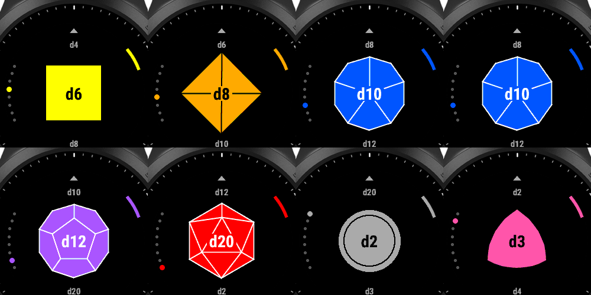
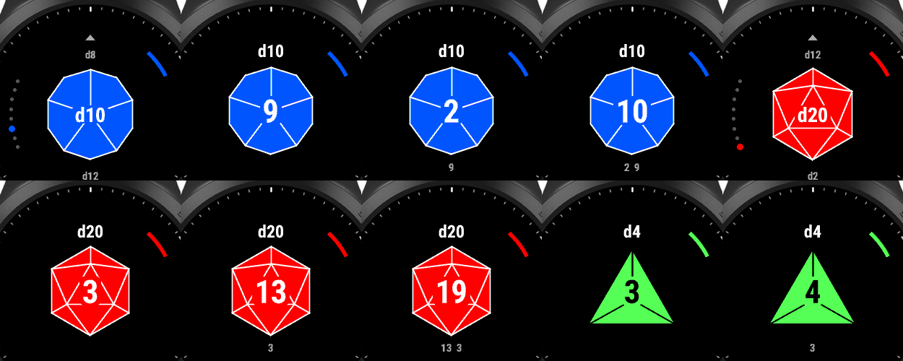

# Dice Roller for Garmin Forerunner 945

A Connect IQ **device app** (watch-app) that rolls d2, d3, d4, d6, d8, d10, d12 and d20.

> **AI-generated:** This app's code, icon and documentation were written by Claude, an AI model made by Anthropic. The repository owner gave the requirements and published the result. It was tested in the Connect IQ simulator. It's provided as-is under the MIT license, so review the code before relying on it.




## Controls

| Screen | Button | Action |
|---|---|---|
| Picker | UP / DOWN | Scroll through the dice (wraps around) |
| Picker | START | Pick the die and open the roll screen |
| Roll | START | Roll. Press again to re-roll as many times as you like |
| Roll | BACK | Return to the picker |
| Picker | BACK | Exit the app |

The roll screen shows the last 5 results (newest first) and a roll counter. The watch gives a short buzz when a roll lands (if vibration is on). The app reopens on the die you used last.

## Shapes (top-down view of the physical die)

| Die | Shape |
|---|---|
| d2 | Circle (coin). It flips while rolling |
| d3 | Rounded triangle |
| d4 | Triangle with 3 faces (tip up) |
| d6 | Square |
| d8 | Diamond with 4 faces (tip up) |
| d10 | Decagon with 5 kite faces |
| d12 | Decagon with centre pentagon |
| d20 | Hexagon with centre triangle |

## Install on the watch (sideload, no build needed)

1. Download `DiceRoller.prg` from the [latest release](../../releases/latest).
2. Plug the FR945 into your computer with its charging cable.
   - **Windows:** in File Explorer open **This PC → Forerunner 945 → Primary → GARMIN → APPS**.
   - **Mac:** use [Android File Transfer](https://www.android.com/filetransfer/) or OpenMTP to open **GARMIN → APPS**.
3. Copy `DiceRoller.prg` into `APPS`.
4. Unplug the watch. It installs the app on disconnect.
5. On the watch: press **START** from the watch face to open the activity list. Scroll to **Dice Roller**. If it isn't listed, scroll to the bottom → **Add** → pick it.

To update, copy the new `.prg` over the old one. To remove it, delete the file from `GARMIN\APPS`.

## Build from source

### Requirements

- [Connect IQ SDK Manager](https://developer.garmin.com/connect-iq/sdk/): install an SDK (built with 7.4.3) and the **Forerunner 945** device files.
- [VS Code](https://code.visualstudio.com/) with the **Monkey C** extension (Garmin).
- A Java runtime.
- A developer key. In VS Code, run `Monkey C: Generate a Developer Key` once.

**VS Code:** open this folder, then use the Command Palette (Ctrl+Shift+P):
- `Monkey C: Build for Device` → pick `fr945` → produces a `.prg`
- Run → Run Without Debugging (Ctrl+F5) → opens it in the simulator

**Command line** (`monkeyc` is in the SDK's `bin` folder):

```bash
monkeyc -r -d fr945 -f monkey.jungle -o bin/DiceRoller.prg -y path/to/developer_key
```

Use `-r` (release build) for any `.prg` you share. Debug builds embed the absolute paths of your source files, including your OS username.

### Project layout

```
manifest.xml          app id, type (watch-app), target device fr945
monkey.jungle         build config
source/Dice.mc        dice table, fair RNG, shape drawing
source/PickerView.mc  dice carousel + input
source/RollView.mc    roll screen, tumble animation + input
resources/            app name string, 40x40 launcher icon
```

### Other watches

Only the Forerunner 945 is targeted and tested. The drawing scales with screen size, so other round watches will probably work. Add the device to `<iq:products>` in `manifest.xml`, download its device files in the SDK Manager, and check it in the simulator.

## Optional: publish to the Connect IQ Store

1. `Monkey C: Export Project` → produces `DiceRoller.iq`.
2. Sign in at https://apps.garmin.com/developer → upload the `.iq` with a description and screenshots.
3. Garmin reviews it (typically a few days), and then it installs from the Connect IQ mobile app like any other app.

Keep the same developer key for every build of a published app. Store updates must be signed with the original key.

## License

[MIT](LICENSE)
